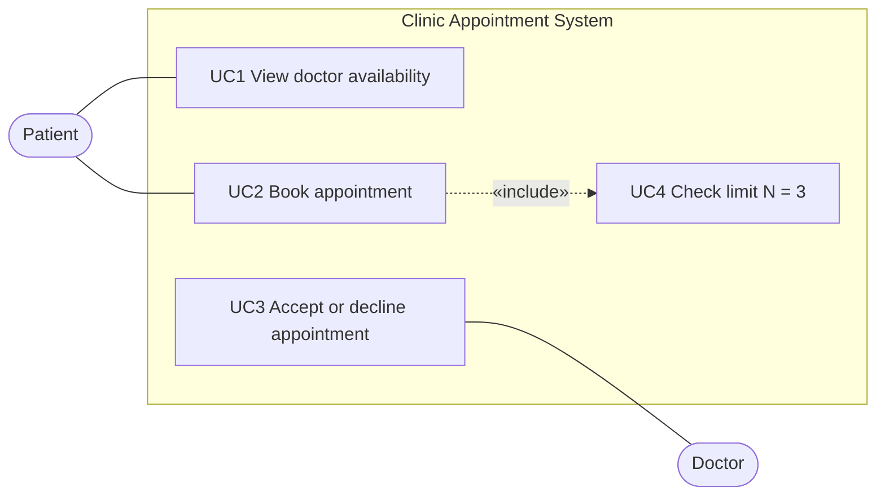

# 2. Use Cases (P2 and P3)

Actors: Patient, Doctor. The System checks the limit (it is not an actor).

| UC | Name | Actor | Requirement | Use case text |
|---|---|---|---|---|
| UC1 | View doctor availability | Patient | R1 | As Patient I view the days and times when a doctor is available. |
| UC2 | Book appointment | Patient | R2 | As Patient I book an appointment in an available time slot. |
| UC3 | Accept or decline appointment | Doctor | R3 | As Doctor I accept or decline an appointment request. |
| UC4 | Check appointment limit | System | R4 | As System I check that the patient has fewer than N = 3 upcoming appointments. |

## UC2 Book appointment: main flow
1. Patient chooses a doctor and an available time slot.
2. Patient submits the booking.
3. System counts the patient's upcoming appointments (UC4: future, status Pending or Accepted).
4. The count is less than N = 3, so the System creates the appointment with status PENDING and marks the slot as reserved.
5. Patient sees "PENDING: waiting for the doctor".

## UC2 Alternative flow 3a: limit reached
3a. The count is already N = 3 (or more).
1. System refuses the booking and shows "maximum of 3 upcoming appointments reached".
2. No appointment is created and the slot stays available.

## UC3 Accept or decline: main flow
1. Doctor opens a PENDING appointment request.
2. Doctor accepts: status becomes ACCEPTED.
   If Doctor declines: status becomes DECLINED and the slot becomes available again.

## Use case diagram (P3)

